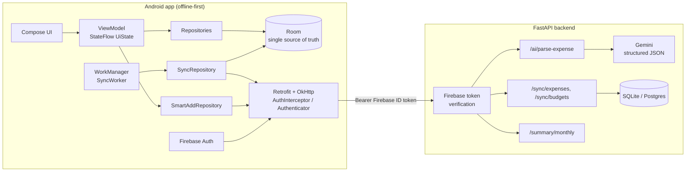

# Architecture



## Data flow rules
1. The UI reads only Room (via Flow). The network never feeds the UI directly.
2. Every write goes to Room first, marked `PENDING`, then asks WorkManager to sync.
3. The server takes `userId` from the verified token, never the request body.
4. AI output is a suggestion: it pre-fills the form and the user must press Save.

## Sync protocol
```
client: POST /sync/expenses { changes: [PENDING rows], lastSyncAt: cursor }
server: for each change -> accept (newer-or-equal updatedAt) | reject(stale|forbidden|future|duplicate)
        respond { accepted, rejected, serverChanges (synced_at > cursor), serverTime }
client: accepted -> SYNCED (only if row unchanged since send)
        serverChanges -> applied only if strictly newer than local (LWW)
        cursor = serverTime
```
Two clocks on purpose: `updatedAt` (client) picks the winner; `synced_at` (server) picks what to
send to other devices, so a late-arriving old edit still reaches everyone.

## Money
Stored as `Long` minor units (paise). Floats can't represent 0.10 exactly, so sums drift; integers are exact.
